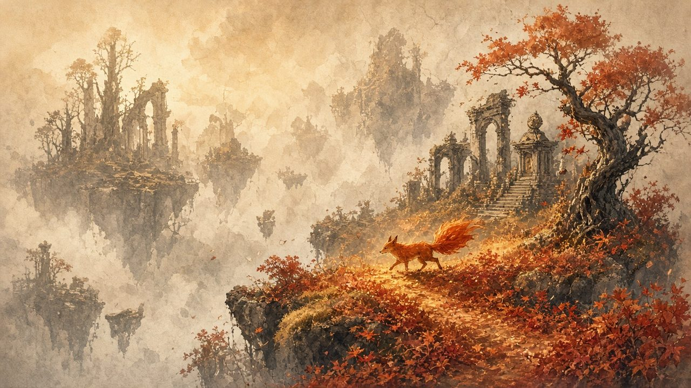
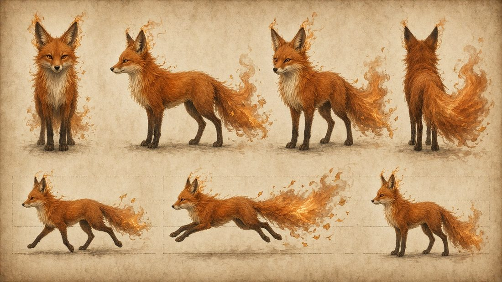

# Autumn Fox — Art Direction

> **North star:** *a faded autumn photograph that a quiet ember of a fox slowly warms back to life.*
> Every frame should work as a still. Sepia is never dull. It is old paper, pressed leaves and dust in late light, deliberately composed.
> **Tone:** melancholic, beautiful, hushed (Ghibli stillness, Ōkami's restoration, Journey's wordless companionship). It should feel like a held breath at the end of a season. It is not a party.

**Status:** LOCKED by Vivek (t24u). This rewrite supersedes every earlier draft. The cream body, rainbow tail, "plush" fox, "living prism", green regrowth and cool ink-grey world are **retired**. Ignore `assets/concept/old/`.

**Canonical concept art overrides any hex value or prose below where they disagree.**

| Key art: sepia floating ruins, one maple still burning | Fox turnaround: burnt-orange ember spirit |
|---|---|
|  |  |

Source copies: `assets/concept/world-keyart.jpg`, `assets/concept/fox-turnaround.jpg`, `assets/concept/ART_LOCK.md`.
Companion docs: [`game-design.md`](game-design.md) (rules, numbers), [`world-1.md`](world-1.md) (Russetvale layout), [`story.md`](story.md) (The Keeping).
Lookdev code: `src/render/` (ColorField, sky, post stack, ember motes). Showcase: `games/fox-spirit/`.

### Open questions (Vivek)

| # | Question | Proposal |
|---|----------|----------|
| A1 | How much fire is on the fox at rest? | **Smoulder at idle and flame in motion.** Wisp emissive scales with speed (§3.3). |
| A2 | Painterly or clean restored color? | **Painterly.** Watercolor bleed edges and leaf-litter splotches, as in the key-art foreground. |
| A3 | Outline: post-process ink edge or inverted hull? | **Post edge** (depth and normal Sobel), weighted by depth. The fox gets no outline. |
| A4 | Fox scale | **0.55 m to the ear tips**, with natural proportions. Readability comes from the camera and the ember rim. |

---

## 1. Visual pillars

| Pillar | Means | Test |
|--------|-------|------|
| **Living hearth in a pressed world** | The fox is the only fully saturated, moving warm thing in a sepia frame | Grayscale the frame: the fox still separates by its rim and value. Restore saturation and it is the most saturated cluster |
| **Autumn is the reward** | Restoration brings back rust, crimson, gold and copper light, never green spring or rainbow | No cyan, magenta, pastel or lime anywhere in W1 |
| **Quiet over busy** | Few effects, slow motion, large negative space (mist, cloud sea) | A frame should still work as a print on a wall |
| **Readable play under painterly skin** | Paper grain and foliage never hide landing edges | 3-value thumbnail shows every landing surface within 30 m |

---

## 2. Palette

### 2.1 Sepia world (pre-restore): "Pressed"

The drained world is an **old sepia photograph**: warm paper highlights, ochre mid-tones and restrained umber shadow. It is neither grayscale nor cool ink. The world *is* still autumn, drained of chroma, like a leaf left in a book for a hundred years.

| Token | Hex | L* (approx.) | Use |
|-------|-----|--------------|-----|
| `paper-hi` | `#EADFC8` | 89 | Lit paper, highlights, bright mist. Highest world value (**never `#FFF`**) |
| `haze-near` | `#D8C8A6` | 81 | Sky billows, cloud sea, near haze |
| `haze-far` | `#B9A47E` | 68 | Distant islands, far fog |
| `ochre-wash` | `#A08B6A` | 58 | Mid-ground stone, ruins, dried grass |
| `umber-mid` | `#6E5A44` | 39 | Shaded faces, trunks, bark |
| `sepia-dark` | `#3A2E24` | 20 | Island undersides, deep shade |
| `sepia-ink` | `#1F1914` | 9 | Ash creatures, outlines, ink pools. Lowest world value (**never `#000`**) |

**Rules**
- **Chroma cap:** world saturation **≤ 15 % HSL** pre-restore, with every hue pulled toward the sepia hue (~35°). The fox is orange too. It reads only because it is the *saturated* orange in a desaturated orange world.
- **Value bands:** foreground L* 25–55, mid 50–70, far 68–89. Distance fog pushes toward `haze-far`, so far is pale and warm and near is darker umber.
- **Grain restraint:** paper fiber ±4 % albedo and foxing spots only in shadow regions L* < 45. Grain **must not** cross landing silhouettes or the fox outline.
- **Ash creatures stay at `sepia-ink` value** even in restored zones. They never take on color while they are hostile.

### 2.2 Restored autumn hues (per world)

The worlds follow the year turning: **Ember → Frost → Pine → Night** (see `game-design.md` §5).

| World | Name | Primary | Secondary | Accent | Restored sky | A11y pattern |
|-------|------|---------|-----------|--------|--------------|--------------|
| **W1** | **Ember: Russetvale** | Russet `#A8441F`, maple red `#B8321F` | Golden grass `#C9A04A`, amber `#E08A2B` | Copper glint `#D8813A`, deep pine `#2F4A3A` framing | Amber haze `#F0CE96`, low sun through warm cloud | Leaf veins |
| W2 | Frost | Frost-blue `#7FA3B8` | Slate `#3E5A6E` | Rime `#E8EEF0`, one last rust leaf | `#B7C4D0` → peach horizon `#E7B58C` | Ice crystals |
| W3 | Pine | Deep pine `#2F5A43` | Moss-black `#1C3328` | Lichen gold `#C9A35A` | Cold clear `#D7DFD3` | Needles |
| W4 | Night | Night violet `#4B3B78` | Indigo `#221A3D` | Warm starlight `#E9D9A6` | `#1E1836` → `#7A5C8E` | Stars |
| Hub | Lanternhollow | Cumulative. Each world warms one leaf of the Great Well's stone maple crest and one quarter of the village takes that season | | | | |

**The 70 / 20 / 10 rule for a restored region:** 70 % muted primary and secondary (saturation 40–55 %), 20 % sepia paper tones that *stay*, and 10 % high-saturation accent (single maples in full flame, maple seals, lantern flames). Autumn looks beautiful because its color is *scattered* through brown and gold, not spread wall to wall. **The fox stays the most saturated thing on screen.**

### 2.3 Matched before / after (W1 vista spec)

The key art's foreground-colored / background-faded split is the **target composition for the Wellspring flood vista** (`world-1.md` §2.4). The rules below separate the three cases so the boundary always means something:

| Case | Where it shows | Saturation | Edge | Persists? |
|------|----------------|-----------|------|-----------|
| **Atmospheric perspective** | Distance > 120 m, any state | Falls to 20 % of local by 300 m | Smooth fog gradient | Always |
| **Temporary (ember wake / Burst)** | Around the fox and its recent path | 80 % (aura) / 100 % (Burst) | Noise-broken watercolor edge, 0.4 m feather | No. Fades in 3.5 s (trail) or 6 s (Burst) |
| **Permanent (Seedwell / Wellspring)** | Inside the restored SDF region | 100 % authored | 2 m (Seedwell) / 4 m (flood) light band, then settles to a soft 6 m blend | Yes. Saved |

Reference frames to capture in every review: Portal arrival (0, 92) looking north, **before** and **after** the flood, from the same camera.

---

## 3. The fox (per turnaround)

**Grounded, quiet, mysterious.** It has natural red-fox anatomy, slender quadruped legs, a long muzzle and narrow amber eyes. It never smiles or mugs to camera. Emotion lives in the ears, the tail and the gait. It should feel like something glimpsed at the edge of a wood at dusk.

### 3.1 Material table

| Part | Color | Material / notes |
|------|-------|------------------|
| Body fur | Burnt orange `#C25A1F` | Shell fur (8 shells) plus fringe cards. Real, slightly wild texture with wrap lighting 0.5. **Not plush** |
| Spine / saddle | Deep rust `#9A3F16` | Darker band shoulder → tail root |
| Chest, cheeks, muzzle underside | Warm cream `#E9D6B8` | Matte. Soft ruff at the throat (turnaround front view) |
| Legs ("socks") | Charcoal-umber `#2E2420` | Matte. Socks run up to the elbow and hock, then feather into rust over 3 cm |
| Ear backs | Dark umber `#2A1A12` | Matte. Ear inners are cream `#D9C3A0` |
| Nose, lip line | `#1A1310` | Satin, roughness 0.45 |
| Eyes | **Narrow amber** `#E0A030`, dark pupil, one small glint | Glossy, emission 0.3 so they catch in shade |
| Ear-tip wisps | Ember `#F08A2A` → gold `#FFC35A` | Additive flame cards with slow flicker. They shed a spark every 1–2 s |
| Tail | Fur at the root, **dissolving into flame, smoke and falling leaf flakes** in the outer 40 % | Emissive 1.2–2.0, additive edges, leaf-flake particles (`src/render/wisps.ts`) |
| Chest / hock fringe | Faint ember edge | Emissive 0.4, visible only in shade |
| Rim | `#F08A2A` at 0.35 | Separates the fox from orange-brown backgrounds |

```
TAIL EMBER RAMP (root → tip), 256×1 texture
#7A2A0E ─▶ #B4471E ─▶ #D2561A ─▶ #F08A2A ─▶ #FFC35A
deep rust   rust      burnt orange  ember     gold (tip, brightest)
```

The fox, its wisps, its trail ribbon and the UI **bypass the world mask**.

### 3.2 Silhouette and proportion

| Measure | Value |
|---------|-------|
| Height to ear tips | 0.55 m |
| Body length (nose → tail root) | 0.75 m |
| Tail | 1.0× body length in fur + up to 0.4× in wisps |
| Leg : body-depth ratio | ≈ 1.3 : 1 (slender, as in the turnaround) |
| Readable at | 32 px tall (thumbnail test) |

### 3.3 Spirit fire: restraint by state

| State | Ear wisps | Tail flame | Particles |
|-------|-----------|------------|-----------|
| Idle / stalk | Smoulder, emissive 0.6, 2 cm flames | Outer 25 % flame, slow curl | 1 leaf flake / 2 s, 3 embers/s |
| Run | 0.9, flames trail backward | Outer 40 %, streams behind | 20 embers/s, 2 leaf cards/s kicked from the ground |
| Dash | 1.4 flare (2 frames) | Full streak, heat shimmer | 2× embers, 2-frame afterimage |
| Glide | 1.0 | **Fanned wide like smoke**, a long flat fan | Leaf flakes peel off the fan edge |
| Ember Burst | Gold flare, 2 frames | All wisps lift at once | Radial ring of leaves |
| 1 wisp left (low health) | Gutter: flicker, gray smoke | Shrinks to 15 %, smoky | Ash flecks instead of embers |

### 3.4 Animation language
- Restrained anatomical compression on landing (shoulders drop 4–6 cm, neck dips, tail follows through over 0.3 s). **No mascot squash/stretch.**
- Idle is a quiet watchful posture: weight shifts, ear flicks every 3–6 s, a slow head turn toward the nearest Seedwell.
- Run cycle is a fox lope (turnaround bottom row). Sprint and dash become an extended gallop, with the tail held straight back.
- Tail is the expressive channel. It lifts on discovery and sinks in the rain.

---

## 4. Shape language

| Element | Shapes | Rules |
|---------|--------|-------|
| Fox | Long S-curves, a narrow wedge head, tapering wisps | No cartoon roundness |
| Floating islands | Flat walkable tops with **crumbling, root-hung undersides** (key art) | Top: soft leaf litter. Underside: eroded stone and roots |
| Trees | Gnarled, twisted trunks (the key-art maple), maple crowns built from leaf-card clusters, bare twisted trees | Big-medium-small mass grouping 60/30/10 |
| Architecture | Weathered stone arches, a domed shrine, stairs (key art), timber-and-stone houses (hub) | Nothing perfectly vertical (1–4° lean). Leaves in every crack |
| Ash creatures | Brittle, cracked, jagged, shedding flakes | The **only** hard and jagged shapes, so sharp = danger |
| Seedwells / Wellspring | Ensō circles, carved maple-leaf seals, spirals | Geometric purity = sacred |
| Ghost-ink platforms | Faint sepia sketch outlines wavering like heat haze | Read as "a memory, not yet real" |

### 4.1 Gameplay readability rules (translating the key art)
- Landing tops are **2+ value steps lighter** than the surrounding underside and void.
- Leaf piles and grass never exceed **0.25 m** on walkable surfaces, so feet stay visible.
- Maple crown pads (Amberwood) are flattened and have a **lighter top band**, so they read as platforms from below.
- Glide targets beyond 20 m get a **landmark accent** (lantern, lone maple, arch) that stays readable through haze.
- Use dense foliage for framing only, never in the jump arc.

---

## 5. Lighting moods

The pre-restore world is lit warm and diffuse: amber light through cream haze, as in the key art. **It is not cold or overcast-grey.** The restored world adds low directional sun, long shadows and backlit leaves.

| Parameter | **Pre-restore: "Pressed"** | **Post-restore: "Late Light"** |
|-----------|----------------------------|--------------------------------|
| Key light | Warm diffuse `#EAD8B8`, intensity 1.6, elevation 50° | Low autumn sun 3900 K `#FFC98A`, intensity 2.6, **elevation 22°** |
| Fill / hemi | Sky `#D8C8A6` / ground `#3A2E24`, 0.9 | Sky `#F0CE96` / ground `#5A3A22`, 0.7 |
| Environment | Painted sepia sky (`src/render/sky.ts`), env 0.55 | Same sky with amber breaks, env 0.9 |
| Shadows | Very soft (radius 6), opacity 0.4, umber | Directional (radius 3), opacity 0.6, cool contrast `#3A3350` |
| Fog | `#D8C8A6`, density 0.013, dusty cloud sea | `#F0D9AE`, density 0.008, sun shafts. Distant islands still fade |
| Bloom | Threshold 0.9, strength 0.3 (fox, Seedwells only) | Threshold 0.8, strength 0.5, rust-tinted |
| Exposure (ACES) | 0.92 | 1.05 |
| Atmosphere | Dust and paper flecks drift slowly. **Leaves hang motionless in the air** | Leaves fall, embers drift, a few birds fly south |
| Vignette | 0.4 with paper-edge texture | 0.2 |

**Transition:** every parameter lerps over the flood's 6 s, keyed to the flood-front radius (locally first, then globally). The sun visibly *sinks* from 50° to 22°.

| Special mood | Where | Notes |
|--------------|-------|-------|
| Lantern dusk | Lanternhollow after each world | Checkpoint lanterns are the warm keys. Sky is one step darker |
| Marsh mist | Reedmarsh | Fog density ×2 below y 4, ink pools reflect `paper-hi` |
| Canopy | Amberwood | Dappled gobo light. After SW3, leaves are backlit like stained glass |
| Warden arena | Wellspring Hill | Ash-gray haze. The only light is the fox and the dim ember in the Warden's cracks |

---

## 6. VFX language

Every effect is **ember** (light, heat, sparks), **leaf** (maple leaves falling or drifting) or **wash** (watercolor bleed of autumn color). Banned: rainbow trails, pollen, confetti, sparkle stars, glitter, cyan or magenta magic.

### 6.1 State rules (temporary vs permanent)

Numbers are mirrored in `game-design.md` §4.

| Effect | Radius / size | Lifetime | Mask write | Activation |
|--------|---------------|----------|------------|------------|
| Aura | 3.0 m, 0.4 m feathered noise edge | While the fox is present | 80 % | Always on |
| Trail ribbon | 0.35 m wide | 2.5 s | None (visual only) | Moving > 1 m/s |
| Trail stain | 0.5 → 1.6 m bloom in 0.25 s | Decays over 3.5 s, edges first (photograph aging) | 64-sample ring buffer, every 0.4 m | Grounded or gliding < 3 m above ground |
| Ember Burst | 6 m ring | Holds 6 s, then fades edge-inward over 0.6 s | 100 % | JUMP + DASH on the ground, 40 Spark |
| Pounce Slam impact | 3 m ring | 2 s | 100 % | JUMP + DASH in the air |
| Seedwell | 30–40 m (per `world-1.md` §2.4) | Permanent | SDF region, saved | Seedwell lit |
| Wellspring flood | Whole realm | Permanent | Realm flag, saved | Warden beaten and seal touched |

### 6.2 Ember wake (aura + trail)
- Inside the aura, albedo returns to authored autumn color at 80 % saturation.
- The trail ribbon uses a smoke-and-ember alpha texture colored by the ember ramp, rust at the old end and gold at the fresh end.
- The stain decays as color *fading back to sepia from its edges*, eroded by noise, not as a uniform fade.
- Dash adds a heat-shimmer smear and a 2-frame ember afterimage.

### 6.3 Ember Burst
- 0.00 s: wisps flare gold (2 frames), hit-stop 50 ms.
- 0.05–0.30 s: a warm ring expands to 6 m with a watercolor-bleed edge, lifting a ring of leaves off the ground.
- Ghost-ink objects in range "ink in": sketched outlines fill solid in 0.15 s.
- At 5.4 s the edge begins to curl inward like burning paper. That is the warning to move.

### 6.4 Seedwell (local restore)
- The stone seal cracks and warm light leaks out through emissive lines (0.6 s).
- An 8 m column of embers and leaves rises.
- The flood front expands to 30–40 m at **25 m/s**. Its leading 2 m band is warm light (`#FFC98A`, emissive 1.2), with saturated autumn behind it and a curtain of held leaves that finally **fall**.
- A permanent **color river** follows: a 2 m amber ribbon of drifting leaves running toward the Wellspring.

### 6.5 Ember Wellspring flood (realm)

| t (s) | Event |
|-------|-------|
| 0.0 | Silence. The seal shatters into sepia-ink shards that turn into maple leaves mid-air |
| 0.3 | 60 m column of warm light, with god rays through the haze (0.5 strength) |
| 0.5–4.5 | The flood front crosses the realm at **40 m/s**, with a 4 m light band |
| 0.5–6.0 | Lighting lerps Pressed → Late Light. The sun sinks to 22°. Bloom swells +0.25 at the 2 s peak |
| 1.0–5.0 | Triggered by radius: grass turns gold, windmills turn, **every held leaf starts falling**, birds lift and fly south (80 boids in a long V) |
| 6.0 | Settles into a steady leaf-fall (≈ 40 leaves/s within 30 m of the camera). Save flag written |

### 6.6 Ambient VFX budget

| System | Pre-restore | Post-restore | Cap |
|--------|-------------|--------------|-----|
| Dust / paper flecks | 120 within 30 m | 40 | 200 |
| Hanging leaves (frozen) | 300 per zone, 0.02 m sway | Released, then recycled | 600 |
| Falling leaves | 0 | 40/s near the camera | 800 alive |
| Embers (world) | Only at the Wellspring maple | Lanterns + hearth sockets | 300 |

---

## 7. Materials (three.js)

### 7.1 Approach: soft PBR with stylized lighting (not hard toon)
`MeshStandardMaterial` / `MeshPhysicalMaterial` extended with `onBeforeCompile` chunks:
1. **World color mask** (`src/render/colorField.ts`) combines the aura, the trail samples and the `restore(center, radius)` SDF regions into a saturation factor. Below 1.0 it blends toward a **sepia gradient map** (`sepia-ink … paper-hi` over luma) and clamps chroma to 15 %.
2. **Wrap diffuse + soft 3-band ramp** (smoothstep, 0.15 softness) for a painted look that keeps PBR spec and env response.
3. **Paper grain + foxing**: triplanar fiber texture ±4 % plus sparse age spots in the sepia state, in shadow only (§2.1).
4. **Sepia wash in shade**: blend toward `sepia-dark` through an FBM mask (blotchy brushwork) at 25 %.

Roughness is 0.65–0.9 for nature and 0.4 for wet or shrine stone. Metalness is 0 everywhere except shrine bronze and maple seals (0.8).

### 7.2 Material table

| Material | Spec |
|----------|------|
| Fox | §3.1. Shell fur + emissive flame cards, flow-noise UV scroll. Bypasses the mask |
| Leaf litter ground | Albedo atlas of 6 maple-leaf types. Restored: russet, crimson, gold. Roughness 0.85 |
| Maple foliage cards | Alpha-to-coverage + SMAA, two-sided with translucency 0.35 (backlit glow when restored). Pre-restore sway 0.02 m, post-restore 0.15 m |
| Golden grass | Wind-grass shader. Sepia: stiff and pale. Restored: `#C9A04A` tips over `#7A5A2A` roots |
| Ruin stone | Pale weathered stone (key-art arches), moss replaced by rust lichen, roughness 0.8 |
| Seedwell / Wellspring stone | Ruin stone + emissive crack mask + **copper maple-leaf inlay** that lights at activation |
| Ash creature | Satin sepia-black (roughness 0.5), cracked, with a hollow dark interior and flakes shed as vertex-animated cards. Pale paper eyes (emissive 0.6). Never colored by the mask |
| Ink pool | Planar glossy sepia-black, slow ripple normals, a few dead leaves floating |
| Ghost-ink | Unlit sketched outline (screen-space dash) when inactive. Fills to the standard material when the mask exceeds 0.5 |
| Lantern paper | Translucent `#EADFC8`, flame core `#FFC35A`, emissive 1.5 when lit |
| Maple seal (collectible) | Bronze metalness 0.8, ember emissive in the leaf relief |

### 7.3 Outlines
- Post-process ink edges (depth + normal Sobel), 1.5 px at 1080p, color `sepia-ink`, weighted by depth (thicker near, thinner and paler far).
- In restored zones outlines tint toward the region secondary (W1: deep russet) at 60 %, going from sepia ink to colored pencil.
- The fox has no outline. Its ember rim separates it.

### 7.4 Renderer stack (UHQ bar)
WebGL2 · ACES filmic · sRGB output · soft shadows (PCFSoft or VSM, 2048 map) · height fog · `src/render/postStack.ts`: SMAA, selective bloom, **sepia grade LUT**, ink edge, vignette, paper overlay. SSAO is optional.
**Target 60 fps at 1280×720 on a laptop iGPU.** Fallback: drop the edge pass and halve bloom resolution. SwiftShader runs are for visual review only, never for perf numbers.

---

## 8. UI and collectible motifs

Quiet, sparse and diegetic: hand-lettered on paper, nothing bouncy.

| Element | Motif | Spec |
|---------|-------|------|
| HUD | **Diegetic first.** Health = 3 tail wisps. Spark = brightness of the tail's ember core | Optional minimal HUD (a11y, `game-design.md` §10) |
| Ember counter | Brush-stroke ensō with one ember inside. Shows 3 s after a pickup, then fades | Bottom-left, 44 px, hand-lettered serif numerals |
| **Ember mote (1)** | Small floating coal of light with a faint ash halo | Ember ramp, 0.08 m bob, soft flicker, **no spin** |
| **Leaf mote (5)** | Single glowing maple leaf turning in the air | Russet → gold, 45°/s turn |
| **Maple seal (25)** | Palm-sized bronze disc with a maple relief, like a wax seal | Copper + ember glow, quiet hum |
| **Ash mote (5)** | Dull gray cinder with a hairline crack | Wakes into a leaf mote when colored (aura or Burst) |
| Seedwell icon | Ensō with a maple samara | Unlit: sepia. Lit: amber fill |
| Wellspring icon | Double ensō with a spiral | Map and pause screen |
| Lost Kit icon | Tiny sleeping-fox silhouette in sepia ink | Fills with the ember ramp when found |
| Pressed page | Torn Album page with a pressed leaf | Sepia until read |
| Checkpoint lantern | Paper lantern with an original, non-linguistic brush glyph | Lights with one warm flame |
| Pause / map | **The Scribe's Album**: hand-drawn sepia pages, restored regions painted in autumn watercolor | 0.5 s page-turn |
| Prompts | Brush glyph inside an ink circle | Fade in 0.25 s, at most 1 on screen |
| Typography | Quiet humanist serif (titles) + humanist sans (body) | Title in `sepia-ink` with an ember underglow |

---

## 9. References

| Reference | Why |
|-----------|-----|
| *Journey* | Primary tone: wordless story, a quiet companion, a light-flood climax |
| *Ōkami* | Closest precedent for restoring color. Differentiate: our restoration is motion-driven and quieter, with no brush input |
| *GRIS* | Color returning as emotional progression, one hue per chapter |
| Studio Ghibli (*Whisper of the Heart*, *Totoro*) | Late light, rural hush, spirits glimpsed sideways. Borrow the stillness |
| *Shadow of the Colossus* | Vast empty ruins, a small figure, sorrow in victory (the Ash Warden) |
| *Ori and the Blind Forest* | A glowing spirit hero against a muted world |
| Kitsunebi (fox-fire folklore) | Inspiration for the ember wisps. The fox is our own creature |
| Isaac Levitan, Kawase Hasui | Autumn gold, rust and melancholy light in a limited palette |
| Andrew Wyeth | Sepia and ochre tempera. The value key of the drained world |
| Hasegawa Tōhaku, *Pine Trees* screen | Mist, negative space, forms dissolving into paper |

---

## 10. Quality checklist (each visual review)

- [ ] Side-by-side with `img/fox-turnaround.jpg`: proportions, narrow amber eyes, cream chest, charcoal socks, flame-and-leaf tail. **No smile, no chibi, no plush.**
- [ ] Side-by-side with `img/world-keyart.jpg`: warm haze, paper grain, ruined arches, root-hung undersides, one burning maple.
- [ ] The fox is the most saturated pixel cluster in every pre-restore frame **and** reads against orange-brown backgrounds.
- [ ] Pre-restore world chroma ≤ 15 %. No `#000` or `#FFF` in world albedo.
- [ ] **No rainbow, cyan, magenta, pastel or lime anywhere in W1.**
- [ ] The ember wake is visible at 30 m camera distance and fades from its edges, not uniformly.
- [ ] The before/after vista at Portal arrival matches §2.3. Restored frame passes 70/20/10.
- [ ] The flood reads as "autumn coming back" (warm wash, falling leaves, sinking sun), not as a fade.
- [ ] 3-value thumbnail: every landing surface within 30 m reads. Grain never crosses a landing edge.
- [ ] Ash creatures read by silhouette in both moods.
- [ ] Wisp intensity follows §3.3. The idle fox smoulders and does not blaze.
- [ ] Bloom, SMAA, ACES and soft shadows are on. Fps is logged on real GPU hardware.
- [ ] The frame feels **quiet**: would it work as a still on a wall?
