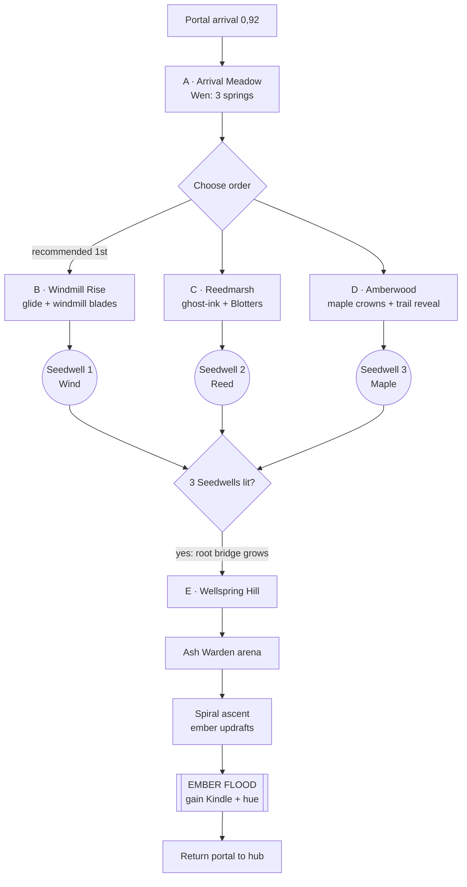

# World 1 — Lanternhollow (hub) + Russetvale (realm)

> Buildable spec. Units are **meters**. Coordinates are `(x, z)` with **+x = east** and **−z = north** (the three.js forward direction). `y` = height above that space's base ground. Each space has its own origin.
> Movement limits come from game-design.md §3.2: jump 6 m / 1.8 m rise, jump+air-dash 10 m, glide ratio 3:1, ember updraft 6 m rise.
> **Target:** critical path **≈ 12 min** (hub 3 + realm 9), full clear ≈ 20 min.
> **Retint (Vivek t24u):** layout, coordinates, timing and shrine structure are unchanged from the previous draft. Names, palette and mood follow the sepia → autumn direction (art-direction.md). *Mossvale* is now **Russetvale**: an autumn valley of rust moss, maples and golden grass. **OPEN QUESTION (Vivek):** Russetvale vs. *Emberfall* (more evocative, but it collides with the Ember hue name).

---

## 0. Pacing overview

```
intensity
  ▲                                                        ★ Warden
  │                                         ┌──┐          ┌──┐   ✦ FLOOD (wonder)
  │                         ┌──┐           │  │  ┌──┐     │  │  ┌───┐
  │            ┌──┐        │  │  ┌──┐     │  │  │  │     │  │  │   │
  │  ┌──┐     │  │  ┌──┐  │  │  │  │     │  │  │  │  ┌──┘  └──┘   └── calm
  │──┘  └─────┘  └──┘  └──┘  └──┘  └─────┘  └──┘  └──┘
  └─────────────────────────────────────────────────────────────► minutes
   0  Hub   3  Meadow 4.5  Windmill  6.5  Marsh  8.5 Amberwood 10.5 Hill 12
   calm      calm      challenge     challenge     wonder      boss → climax
```

---

## 1. HUB — Lanternhollow (120 × 120 m)

A timber-and-stone village on a small floating island around a dry well, ringed by a dusty cloud sea. It starts fully sepia, with leaves hanging motionless in the air above the plaza. Bounds are x −60..60 and z −60..60, with a sheer cliff and cloud sea outside.

### 1.1 ASCII map (1 char ≈ 4 m)

```
 z=-60 ┌──────────────────────────────┐   N
       │ ~~~~~~~ cloud sea ~~~~~~~~~~ │   ▲
       │      ┌──[ REALM GATE ]──┐    │
 z=-40 │      │  Russetvale arch  │    │
       │  W4  └──────┬───────────┘ W2 │  W2/W4 = sealed portals (later)
       │ ◊ seal      │ stair 6 m    ◊ │
 z=-20 │   ▓▓ Library│(Hollin)   ▲▲   │  ▲▲ = belltower (secret H3)
       │   ▓▓ y+8    │          ▲▲   │
 z=  0 │ ░░░░░░░░ ( GREAT WELL ) ░░░░ │  ( ) = dry well, Ø14 m
       │ ░ plaza  *Bramble        ░  │
 z= 20 │  ⌂ ⌂    cart    ⌂ ⌂   W3 ◊  │  ⌂ = houses (roofs = mote lines)
       │  ⌂ ⌂   ·····    ⌂ ⌂         │
 z= 40 │      ● SPAWN LEAF-DRIFT      │
       │   windmill stub   ╱cliff ledge│  (secret H2 under ledge)
 z= 60 └──────────────────────────────┘
      x=-60          x=0           x=60
```

### 1.2 Hub landmarks

| ID | Landmark | (x, z) | y | Notes |
|----|----------|--------|---|-------|
| H-S | Spawn leaf-drift (under a bare maple) | (0, 42) | 0 | Opening cinematic ends here: the ember lands, the fox rises |
| H-B | Old Bramble (sepia statue) | (6, 8) | 0 | First NPC wake |
| H-W | Great Well (dry, Ø14 m) | (0, 0) | 0 → rim 1.2 | Stone maple crest; one leaf warms to the world's hue after each world |
| H-L | Library balcony (Hollin) | (−32, −18) | 8 | Reached by roof-hops |
| H-T | Belltower | (34, −16) | 22 | Vista over the sepia village; glide down to the plaza |
| H-G | **Realm gate: Russetvale** | (0, −46) | 6 | Opens after the hub tutorial (meet Bramble + 1 Burst) |
| H-2/3/4 | Sealed portals W2/W3/W4 | (52, −30) / (50, 22) / (−52, −30) | 0–3 | Stone seals with Frost / Pine / Night glyphs |
| H-C | Checkpoint lantern | (0, 30), (0, −34) | — | Lit by passing through them |

### 1.3 Hub critical path (≈ 3 min)
1. **Wake & move** (0:00–0:40): spawn, run, ember-wake tutorial on the cobbles.
2. **Jump** (0:40–1:00): fallen cart (0.9 m), then house steps (1.5 m).
3. **Bramble** (1:00–1:30): trail wakes her and she points to the well and gate.
4. **Dash + Burst** (1:30–2:30): the 6 m stairs at the gate are blocked by **ghost-ink steps** (faint sepia sketches). Warming them with the wake lets you climb, but they fade too fast. The prompt teaches JUMP+DASH **Ember Burst**, which holds them colored for 6 s.
5. **Gate** (2:30–3:00): Burst on the gate seal to enter Russetvale.

### 1.4 Hub embers: 100

S = ember mote (1), M = leaf mote (5), L = maple seal (25).

| Area | Embers | How |
|------|------|-----|
| Plaza & spawn | 20 | Ember-mote breadcrumbs (S×20) |
| Rooftops | 25 | Roof ridges S×15 + 2×M on chimney tops |
| Library balcony | 15 | S×10 + M×1 |
| Belltower | 15 | S×10 + M×1 (top) |
| Hub secrets H1–H3 | 25 | L×1 (H3) |

### 1.5 Hub secrets
| ID | Where (x, z) | How | Reward |
|----|--------------|-----|--------|
| H1 | Inside the dry well | Pounce Slam on the well's center cap (post-W1 only; shows a crack pre-W1) | Pressed page #1 (backtrack hook) |
| H2 | Under the south cliff ledge (38, 58), y −4 | Drop off the edge and glide back under | Lost Kit #1 |
| H3 | Belltower roof (34, −16), y 22 | Roof chain + air dash | Maple seal (25) |

---

## 2. REALM — Russetvale (260 × 200 m)

A large **floating island** shaped like a shallow bowl, matching `img/world-keyart.jpg` (crumbling root-hung underside, warm sepia haze, ancient stone arches and a domed shrine). Golden-grass meadows in the south, terraced windmill hills to the west, a misty reed marsh to the east, a wood of giant old maples with amber crowns in the center-north, and the **Wellspring Hill** spiral at the far north, crowned with ruined arches and the shrine under a lone burning maple (the key-art tree). Pre-restore, everything is sepia and every leaf hangs still in the air. Bounds x −130..130 and z −100..100. The map border is the **island edge**: it drops into the cloud sea, and falling there is the game-design §8 fall respawn. Backdrop: distant floating islets and ruins fading into warm haze at 300–800 m. Glide-reachable satellite islets carry secrets S1/S7.

### 2.1 ASCII map (1 char ≈ 6.5 m)

```
  z=-100 ┌────────────────────────────────────────┐  N ▲
         │             ◎ EMBER WELLSPRING         │  ◎ (0,-85) y38
         │          ╭─spiral─╮  Wellspring Hill   │
  z=-60  │          │ ARENA ⊙│  (0,-60) y12       │
         │          ╰───┬────╯                     │
         │ ⇡ ridge      │ root bridge   ⇡ cliff  │
  z=-30  │✿SW1♣  ♣ AMBERWOOD ♣ ♣  ♣♣ ✿SW3          │  ✿ = Seedwell
         │   ♣  (giant maples, crowns y10-30) ♣  │  ✿SW3 (-10,-35) y18
  z=  0  │ ╫╫ ⚙                         ≈≈≈≈≈≈✿SW2│  ✿SW1 (-112,-24) y20
         │ ╫╫ WINDMILL RISE      ≈≈ REEDMARSH ≈≈ │  ✿SW2 (95,10) y2
         │ ╫╫ terraces y0→24     ≈≈ ghost-ink ≈≈ │  ╫ = terraces
  z= 40  │ ╫╫  ⚙ ⚙ ⚙             ≈≈ stilt huts  │  ⚙ = windmills
         │        ╲          ╱ Pockets ⌂         │
  z= 70  │         ARRIVAL MEADOW   (Wen dock)    │
         │         ~~~ pond ~~~                    │
  z=100  │              ● PORTAL ARRIVAL (0,92)   │
         └────────────────────────────────────────┘
       x=-130                 x=0              x=130
```

### 2.2 Critical path flow



Each Seedwell lit = permanent local color (radius in §2.4) + checkpoint + full heal + a **root bridge** shortcut back to the meadow.

### 2.3 Landmarks

| ID | Landmark | (x, z) | y | Size | Sightline role |
|----|----------|--------|---|------|----------------|
| R-P | Portal arrival | (0, 92) | 0 | Ø8 | Faces north: **Wellspring Hill visible on frame 1** |
| R-Wen | Wen's dock + pond | (−18, 70) | 0 | Pond 30×18 | Calm opener |
| R-Mill | 3 windmills | (−70, 40), (−88, 22), (−100, 2) | 6 / 14 / 22 | Blade radius 7 m, period 10 s | Sailcloth blades are pressed sepia and still. They **turn only while in the fox's color** until SW1 is lit, then turn for good |
| R-Hut | Pockets' stilt hut | (60, 52) | 3 | 8×8 | Ember gate (150) → secret S4 |
| R-Marsh | Reedmarsh basin (mist, tall reeds, ink pools) | (75, 25) | −2 (ink at −1.5) | 70×60 | Read from the windmill tops |
| R-Amber | Amberwood maples | centered (0, −20) | trunks 8–30 | 20 giant maples, flat crown pads Ø6–12 m | Canopy route / ground route |
| R-Arena | Warden arena | (0, −60) | 12 | Ø36 plateau | Ring of broken, ash-stained pillars |
| R-WS | **Ember Wellspring** | (0, −85) | 38 | Basin Ø10 | Tallest point; the lone maple above it is the one tree that keeps a faint russet, seen from everywhere |
| R-CK | Checkpoint lanterns | (0, 80), (−55, 35), (55, 40), (0, 0), (0, −44) | — | — | Auto-light |

### 2.4 Shrines

| Shrine | (x, z, y) | Unlock condition | Permanent color radius | Effect |
|--------|-----------|------------------|------------------------|--------|
| **SW1 Wind Seedwell** | (−112, −24, 20) | Reach it | 40 m | Windmills turn for good (blades become a steady moving-platform path), grass turns gold |
| **SW2 Reed Seedwell** | (95, 10, 2) | Light 3 ghost-ink "reed lanterns" with Burst in sequence | 35 m | Ink pools dry into walkable leaf litter. Reeds turn copper. Blotters crumble |
| **SW3 Maple Seedwell** | (−10, −35, 18) | Reach it via the canopy (inside a hollow, sealed trunk that splits open when Burst) | 30 m | Crowns flare russet and crimson, branch bridges grow, the first leaves fall |
| **MAIN: Ember Wellspring** | (0, −85, 38) | 3 Seedwells → root bridge (0, −44); beat the Warden | **Whole realm** (flood front at 40 m/s; ~4 s to reach the rim) | Hue Ember + **Kindle** ability. Hearth sockets across the realm light ember updrafts |

### 2.5 Critical path beats (≈ 9 min realm)

| # | Zone | Est. time | Beat | Pacing |
|---|------|-----------|------|--------|
| 1 | A · Arrival Meadow | 0:00–1:30 | Arrive and see the Wellspring. Gentle rolling hills of pale grass (≤1.5 m), 2 Ashlings, Wen explains the 3 springs. Ash-mote tutorial at the pond | **Calm** |
| 2 | B · Windmill Rise | 1:30–3:30 | Terrace climb (6 terraces × 4 m, with jump + air-dash gaps). Paint windmill blade 2 with the trail so it turns (period 10 s) and ride it up. Dust Moths on the glide line. Launch from mill 3's blade apex (y≈30) and glide 29 m down to the SW1 ledge (y20) | **Challenge (vertical)** |
| 3 | C · Reedmarsh | 3:30–5:30 | Misty ink-pool hazard field. Ghost-ink stepping stones (4–6 m apart) solid only in the trail, so keep moving. 2 Blotters + 1 Quill Knight. Reed-lantern Burst puzzle | **Challenge (rhythm)** |
| 4 | D · Amberwood | 5:30–7:00 | Spiral up maple trunks and branches; crown pads are soft-bounce leaf mats (1.3× jump). The wake reveals hidden **leaf-paths**: strings of hanging leaves that become walkable in color. Little Tam moment. Burst splits the SW3 trunk | **Wonder (quiet)** |
| 5 | Root bridge | 7:00–7:20 | 3 lit springs send amber color rivers converging. A root bridge grows from (0, −30) to (0, −44) | **Breath** |
| 6 | E · Warden arena | 7:20–8:30 | **Ash Warden** (see §2.8) | **Boss-lite** |
| 7 | E · Spiral ascent | 8:30–9:00 | 26 m climb around the hill. The Warden's defeat leaves 3 hearth sockets, so Burst lights the first ember updrafts (ability preview) | **Rising** |
| 8 | Wellspring | 9:00–9:30 | Seal crack → **FLOOD** cinematic (6 s, skippable after first view) → free roam in restored Russetvale, leaves falling | **Climax / wonder** |

### 2.6 Embers: 400 in the realm (500 for World 1 with the hub)

| Zone | Ember mote (1) | Leaf mote (5) | Maple seal (25) | Ash mote (5) | **Total** |
|------|-------|-------|--------|--------------|-----------|
| A · Arrival Meadow | 30 | 2 | 0 | 1 | **45** |
| B · Windmill Rise | 40 | 5 | 1 | 1 | **95** |
| C · Reedmarsh | 30 | 4 | 1 | 3 | **90** |
| D · Amberwood | 35 | 4 | 1 | 2 | **90** |
| E · Wellspring Hill | 25 | 2 | 0 | 2 | **45** |
| Secrets (S1–S7, extra) | 5 | 1 | 1 | 0 | **35** |
| **Total** | 165 | 18 | 4 | 9 | **400** (165 + 90 + 100 + 45) |

> About 55% of embers sit on or within 5 m of the critical path. The rest reward exploring.

### 2.7 Secrets (7)

| ID | Location (x, z, y) | Discovery cue | Solution | Reward |
|----|--------------------|---------------|----------|--------|
| S1 | Behind the waterfall in the pond, (−30, 62, 0) | Sepia mist glints faintly | Dash through the falls | Maple seal (25) |
| S2 | Top of windmill 3's cap, (−100, 2, 34) | Ember motes visible circling the cap | Blade ride, then jump at the top of the rotation | Lost Kit #2 |
| S3 | Marsh sunken ruin, (110, 40, −6) | Ink pool shaped like a door | Only after SW2 dries the marsh: drop in | Pressed page #2 |
| S4 | Pockets' low door, (64, 56, 3) | Pockets tells you | Hold 150 embers (not spent, just a threshold) | Lost Kit #3 |
| S5 | Highest maple crown, (22, −12, 30) | Only reachable via a trail-revealed leaf-path | Glide 14 m along a hanging-leaf air-path (ghost-ink) | Leaf mote ×1 + vista |
| S6 | Under the root bridge, (4, −38, 2) | Glint between roots | Glide under the bridge and air-dash back to an alcove | Ember mote ×5 |
| S7 | Wellspring back cliff, (−24, −96, 20) | After the flood, hearth sockets visible | **Requires Kindle** (backtrack, post-flood) | Old stone fox shrine (cosmetic wake tint: gold) |

### 2.8 Enemies and guardian

| Zone | Placement (x, z) | Enemy |
|------|------------------|-------|
| A | (8, 60), (−6, 48) | Ashling ×2 (wandering 6 m) |
| B | (−60, 32), (−80, 14) | Ashling ×2 on terraces |
| B | Glide line from (−100, 2) to (−112, −24) | Dust Moth ×2 (sine amplitude 2 m, period 3 s) |
| C | (70, 35), (88, 18) | Blotter ×2 (spit range 10 m, every 3.5 s) |
| C | (80, 5) | Quill Knight ×1 guarding SW2 |
| C | (60, 30), (75, 45) | Ashling ×2 |
| D | (−8, −10), (12, −28) | Dust Moth ×2 among the trunks |
| D | Ground floor | Ashling ×3 |
| E | Arena (0, −60) | **Ash Warden** |

**Ash Warden** (6 m hound of ash and dried ink, gaunt and cracked, 3 hits; 60–75 s target fight). It reads as grieving, not monstrous:

| Phase | Behavior | Window |
|-------|----------|--------|
| 1 | Pounces at the fox (telegraph: crouch + paper-white eye flash 0.7 s), lands and leaves a 4 m ink pool for 3 s | Burst on it after a landing turns it **colored** for 4 s (a dim ember core shows through the cracks in its back) → Pounce Slam |
| 2 | Pounce plus 2 Ashling spawns, and arena pillars exhale ash rings (jump over, 0.6 m tall) | Same; Ashlings refill Spark |
| 3 | Fast double pounce, arena edge ink rises 2 m (smaller arena, Ø24) | Last slam → it crumbles (the sleeping-hound beat, story §6) |

Spark is guaranteed: the arena has 40 m of looping unrestored path so the player can always refill.

### 2.9 Sightlines and verticality

- **Rule of the Wellspring:** the Wellspring (y38) is visible from **every checkpoint**. The lone maple above it, keeping a faint russet, is the compass.
- From Windmill Rise top (y24) you can read the whole marsh and Amberwood, so the player plans the next route.
- From the marsh, the windmills sit on the western skyline and their turning blades (after SW1) show progress.
- Amberwood is the **vertical showcase**: ground y0, mid crowns y10–18, high crowns y24–30. There are 3 vertical routes and the trail reveals the highest.
- Each lit Seedwell sends a visible **color river** along the ground toward the hill (permanent amber ribbon of drifting leaves, 2 m wide), so progress is readable from anywhere.
- Height bands: meadow 0–3, terraces 0–24, marsh −2–4, Amberwood 0–30, hill 12–38. Max drop with no glide: 6 m before −1 wisp (glide always saves).

---

## 3. Trailer shot list

Cut slow. Let shots breathe; silence and a single cello carry the first half. The flood is the only swell.

| # | Shot | Location | Camera | Duration |
|---|------|----------|--------|----------|
| 1 | A sepia Album page draws itself, a leaf stops in mid-air, the page becomes the 3D hub | Opening | Top-down → 45° crane | 5 s |
| 2 | An ember drifts down into a leaf-drift; smoke; the fox rises and shakes ash from its coat | Hub spawn (0, 42) | Low 20 cm angle, 85 mm, slow-mo 0.5× | 4 s |
| 3 | The fox lopes across sepia cobbles, its ember wake warming color behind it and fading | Hub plaza | Side-on tracking dolly, 35 mm | 3 s |
| 4 | Old Bramble wakes as warmth washes over her | Hub (6, 8) | Close-up, rack focus fox → Bramble | 3 s |
| 5 | First frame in Russetvale: hanging leaves, haze, the lone maple on the Wellspring hill | Portal (0, 92) | Over-the-shoulder, wide 24 mm | 4 s |
| 6 | Glide off windmill 3, tail wisps fanned like smoke, past the turning sails | (−100, 2) → (−112, −24) | Chase cam, roll 5°, FOV 75 | 4 s |
| 7 | Ghost-ink stones flicker into being under each step across the misty marsh | Reedmarsh | High 3/4 angle, 50 mm | 3 s |
| 8 | The fox climbs the maple crowns; a leaf-path of hanging leaves warms into a bridge | Amberwood | Orbit cam rising 360° | 4 s |
| 9 | Ash Warden pounce, Burst, Pounce Slam; it crumbles, a sleeping hound shape in the ash | Arena | Low wide 18 mm, hit-stop 80 ms | 4 s |
| 10 | **Wellspring flood**: autumn rolls across the valley, the sun sinks, every leaf begins to fall | Wellspring (0, −85, 38) | Drone pull-back from the fox to the whole valley | 6 s |
| 11 | Little Tam settles on the fox's back; leaves falling around them | Wellspring | Close 2-shot, warm low backlight | 3 s |
| 12 | The Scribe on a distant islet; one pressed leaf slips from its Album and drifts away | (−120, −95, 50) | Long lens 200 mm, haze shimmer | 3 s |

---

## 4. Build checklist (engineering)

- [ ] World color mask: aura + 64-sample trail + SDF list (3 Seedwells + realm flood)
- [ ] Ghost-ink platform component (solid iff mask > 0.5 at its center, flash at < 0.6 s left)
- [ ] Ash mote / sepia-statue NPC "wake while colored" component
- [ ] Windmill blade moving platform (period 10 s, turns while colored before SW1 and for good after)
- [ ] Safe-ground sampler + checkpoint lanterns
- [ ] Ash Warden state machine (3 phases)
- [ ] Flood sequence: front radius over time, music cue, camera rail, save flag
- [ ] Hanging-leaf system: leaves frozen in air pre-restore, released to fall by the flood front
- [ ] `window.__game` exposes: `zone`, `embers`, `seedwells[]`, `restored`, `metrics` (rename from `gems` when code is touched)
